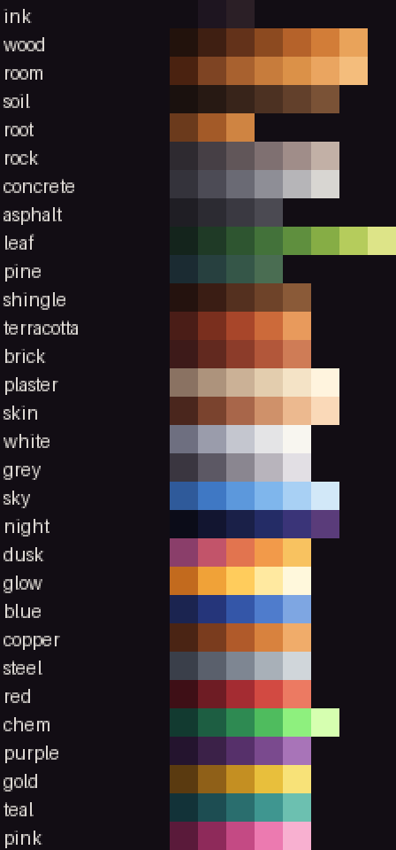

# Art direction

The campaign should look like one painting: a cosy side-view cross-section of a small town, in the spirit of the two
reference images the direction was set from (`docs/design/art-reference-day.jpg` and `art-reference-dusk.jpg`).
Warm wood and plaster, red tile roofs, a dark slice of soil under a band of grass, lamplight against a blue dusk.
The humour lives in the people and the props; the world itself is played straight and pretty.

## Rules

1. **One pixel grid.** One art pixel is one world unit; a cell is 8 × 8 pixels; people and the player are 32 × 48
   frames. Nothing is drawn at a different scale or smoothed.
2. **One palette.** Every colour comes from the ramps in `tools/palette.py` (147 colours in 29 ramps). Scripts draw
   with ramp names (`ramp("wood")[3]`) and pass the finished sheet through `snap()`, which moves any stray colour to
   the nearest palette colour. The world shader uses the same ramps from `godot/generated/campaign_palette.gdshaderinc`,
   which `tools/palette.py` writes. The interface keeps its own slate panels for now.
3. **Hue-shifted ramps.** Shadows lean purple and blue, highlights lean yellow. Never pure black or white: the
   darkest ink is `#120d14`.
4. **Light from the top left.** Highlights on the top and left edges, shade on the bottom and right.
5. **Outlines.** Sprites and props get a one-pixel outline in ink (`ink[1]`) where they meet the air; foliage is
   outlined in its darkest green. Tiles are outlined only where they meet the air (soil `soil[0]`, rock `rock[0]`,
   timber `wood[0]`), with the corners rounded off.
6. **Distance is haze.** The backdrop's layers are blended toward the horizon colour: far 42 %, mid 18 %, near 6 %.
   Only the foreground is fully saturated.
7. **Light is warm, dark is blue.** By day everything is lit white; at night the outdoors goes blue and rooms and lamps
   go warm (`lighting.gd`). Windows in the town light up through dusk.

## How the picture is built

| Layer | Drawn by | Notes |
|---|---|---|
| Sky, sun, moon, stars, clouds | `godot/backdrop.gd` | sky colours by hour: night, dawn, day, dusk; the sun crosses east to west |
| Town in three layers | `tools/make-backdrop.py` → `art/backdrop/` | forest ridges and the church (far), houses and trees (mid), big trees and hedge (near); parallax 0.12, 0.3, 0.55; window lights as separate sheets |
| Cells | `godot/liquid.gdshader` (`styled`) | grass band with hanging blades, soil darker with depth with pebbles and roots, cobbled rock, asphalt with a curb, timber posts and plank floors, brick, clay roof tiles, steel, glass panes; plaster back walls with timber framing; open sky left clear |
| Props | `tools/make-decor-sprites.py` → `art/decor.png`, placed by `data/decor.json`, drawn by `godot/decor.gd` | fence, street lamp, hanging lamp, shelf of jars, plant, chalkboard, sacks, mailbox, for-sale sign, bush, tree, cat |
| Machines, people, the player | `make-equipment-sprites.py`, `make-people-sprites.py`, `make-player-sprites.py` | snapped to the palette |
| Light | `godot/lighting.gd`, `lighting.gdshaderinc`, `sprite_light.gdshader` | outdoor and room light, up to 16 lamps in soft bands; flames give their own light |

Roof tiles (block 82, "Roof" on the hotbar) are laid in courses of four pixels. A roof tile with open air above it
and on one side, standing on a tile that reaches further out, has its top corner cut on the diagonal, so a roof
built to step in one cell a row reads as a 45° slope. The plaster back wall (kind 3, "Plaster") draws a timber post
every eight cells, a beam under a solid ceiling and a skirting board over a solid floor, with the plaster shaded
where it meets them. The shack starts with both.

A prop shows only while what holds it up is there: ground under it, a wall behind it, or a ceiling over it. Dig out
the ground under the fence and that panel goes. A lamp prop adds a light from dusk to dawn and a halo.

The camera frames the player a little low (`FRAME_LIFT` in `main.gd`), so the ground sits in the lower third and the
town fills the sky, as in the references.

## The player

The mad scientist: a shock of white hair, brass goggles pushed up on the forehead, a lab coat with pens in the pocket
and a green chemical splash at the hem, yellow rubber gloves, dark trousers and heavy boots.

## Next

- Window frames with sills and shutters, so buildings can look like the references' houses.
- The delivery van and the tanker redrawn in the cosy style (rounded, shaded, with the supplier's logo).
- The interface panels moved onto the palette.
- PixelLab concept passes for the people and the player, redrawn on this grid and palette.
